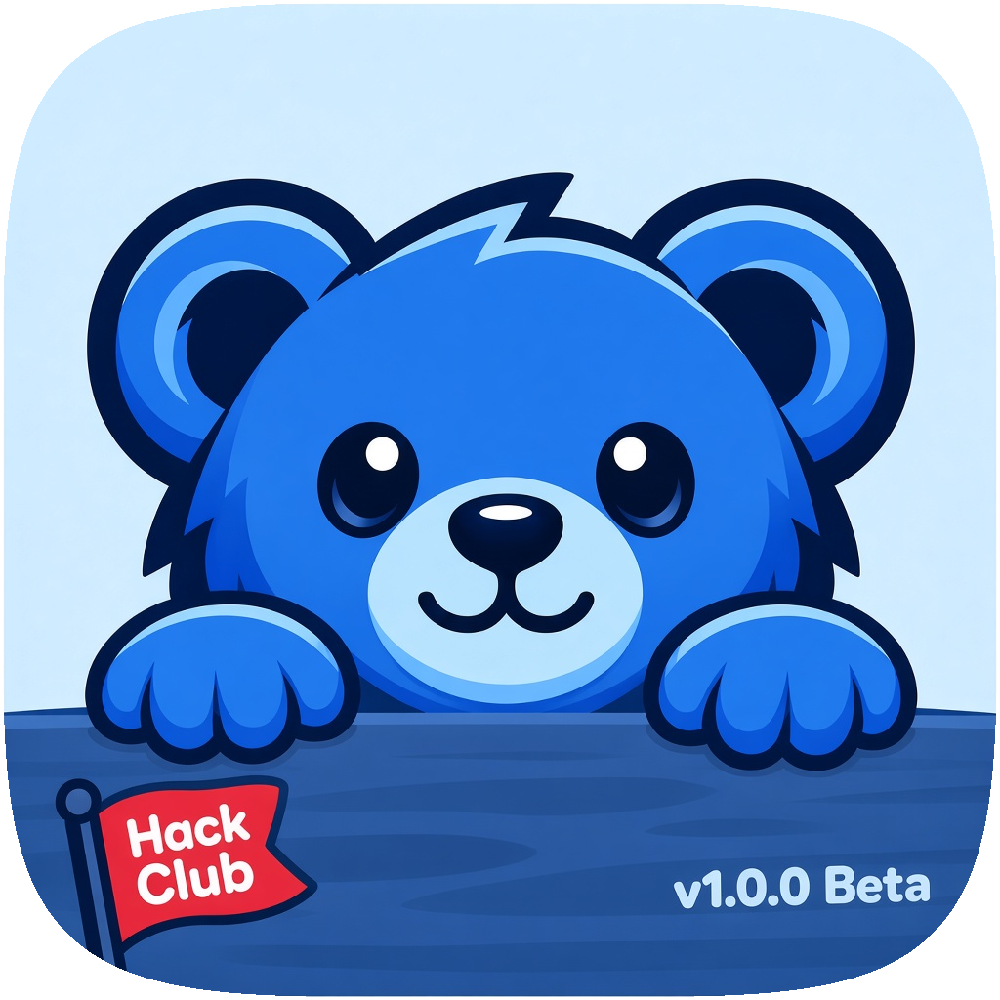

# Buddy

  

Buddy is a desktop AI assistant you can chat with, talk to, and ask to help with everyday computer work. It brings chat, voice, memory, and optional tools into one app, with a friendly interface and a live view of what it is doing.

Buddy is an active beta. Some features need an AI provider, connected accounts, or operating-system permissions before they work.

> [!NOTE]
> Buddy keeps chats and memory on your computer by default. When you use an AI provider or connect a service, the information needed for that request is sent to that provider.

## A quick tour

- **Chat:** Talk through questions and tasks, see Buddy's progress, and return to saved conversations.
- **Talk:** Have a spoken conversation using your microphone and the available speech services on your computer.
- **Memory:** Review and manage facts and preferences Buddy has saved for future chats.
- **Plugins:** Connect services and enable computer tools with controls for their permissions.
- **Coding mode:** Ask Buddy to work on a software project, inspect its changes, and run its checks.

Buddy's interface is a compact desktop app with a navigation sidebar and separate pages for these features. The chat view includes suggestions and a live work log, so you can follow along while Buddy works.

Try asking: **“What can you do?”** Buddy will give examples based on its capability guide in `knowledge/`.

## How it works

Buddy runs as a Python desktop app built with PySide6. `main.py` starts the interface and its local backend. A manager plans a request, then the appropriate worker and enabled tools handle it. Buddy can use a hosted OpenAI-compatible provider by default, or a compatible self-hosted server when configured.

Chats, settings, and memory use a local SQLite database. Tool access depends on the plugins you enable, your connected accounts, and permissions granted to Buddy by your operating system. Actions that could remove data or make significant changes ask for confirmation.

> [!WARNING]
> AI can make mistakes. Review important answers and generated changes. Never paste passwords, API keys, or other secrets into a chat.

## Download Buddy

Go to [**Releases**](https://github.com/shreyanshoffline/Buddy/releases/latest) and download the installer for your computer:

| Computer | Download |
| --- | --- |
| Mac with Apple silicon (M1 or newer) | The Apple silicon `.dmg` |
| Intel Mac | The Intel `.dmg` |
| Windows 10/11, 64-bit | The Windows `.exe` installer |
| Linux, x86_64 | The `.AppImage` or `.deb` |
| Chromebook with Linux enabled | The Linux `.deb` |

On Mac, open the `.dmg` and drag Buddy into **Applications**. On Windows, open the `.exe` and follow the installer. Linux and ChromeOS installation steps may differ by distribution.

> [!NOTE]
> Choose the Mac download that matches your processor. Apple silicon Macs use the Apple silicon DMG; older Intel Macs use the Intel DMG. The `.zip` files listed in Releases are for Buddy's updater, not the regular installer.

Unsigned downloads may show a security prompt on macOS or Windows. On macOS, you may need to approve Buddy in **System Settings → Privacy & Security** the first time you open it.

## See Buddy

Add screenshots to `docs/images/` and replace these example paths with their filenames. These spots are for real screenshots of the app, so visitors can see Buddy before downloading it.

<!-- Example: save a screenshot as docs/images/chat.png, then remove the HTML comment around the image below. -->
<!--  -->

<!-- Add more screenshots here, for example the Memory, Talk, or Plugins screens. -->
<!--  -->
<!--  -->
<!--  -->

## Tour of the repository

| Folder or file | What's inside |
| --- | --- |
| `main.py` | Starts the desktop app and local backend |
| `gui/` | Screens, widgets, and images |
| `core/` | Chat orchestration, prompts, plugins, and updates |
| `tools/` | Computer actions and service integrations |
| `storage/` | SQLite database and migrations |
| `knowledge/` | Guides and capability instructions Buddy can use |
| `backend/` | Local service and runtime support |
| `packaging/` | App builds, installers, icons, and release guide |
| `.github/workflows/` | Automated tests and release builds |
| `tests/` | Offline regression tests |
| `ARCHITECTURE.md` | A concise map of how the code fits together |

## Credits

Buddy was created and is led by **Shreyansh**. The product direction, feature choices, and project decisions come from him.

AI tools were used for most of the user-interface implementation, to help with compilation and packaging, and to help write the instruction documents Buddy uses to guide its work. The project owner reviews and directs that work.

The Memory icon is based on the [Lucide brain icon](https://lucide.dev/icons/brain), distributed under the ISC License.

## License

No license has been declared yet. Until one is added, treat this repository as source-available and ask before redistributing it.
