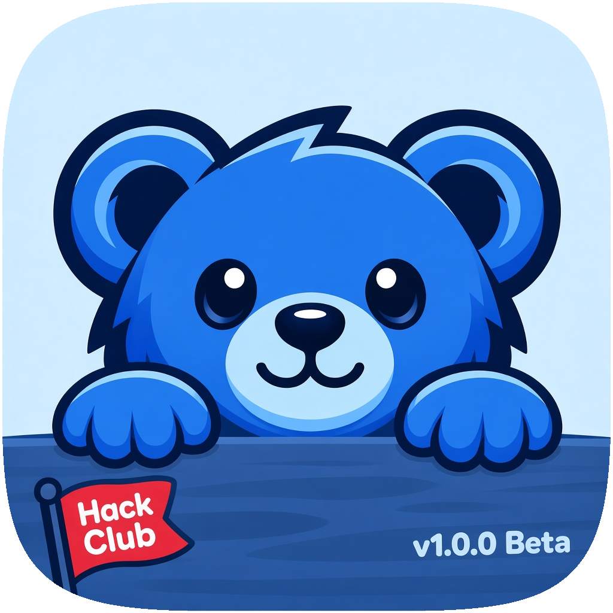
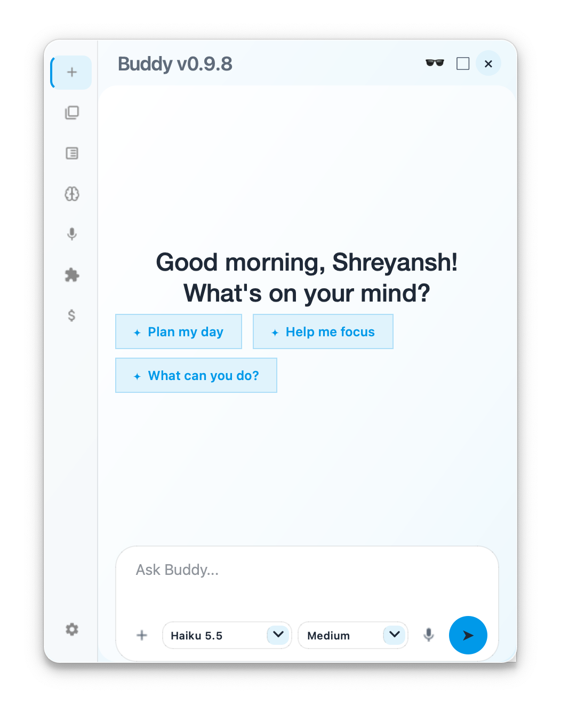
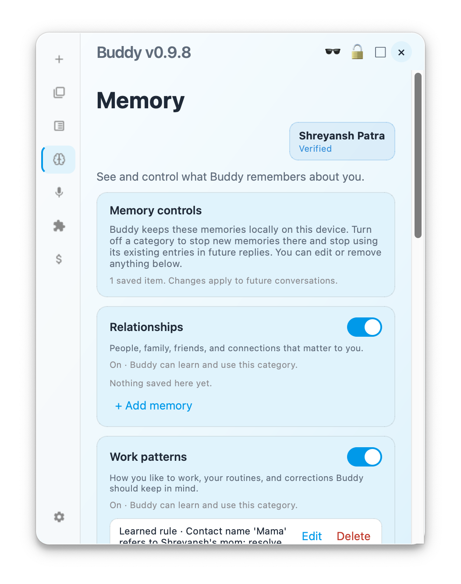
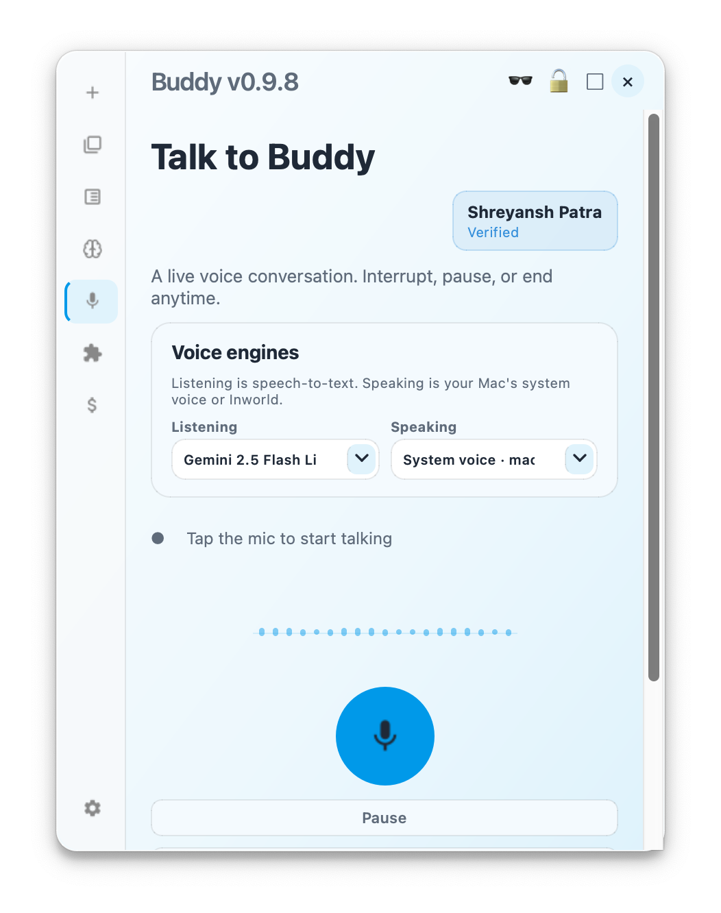
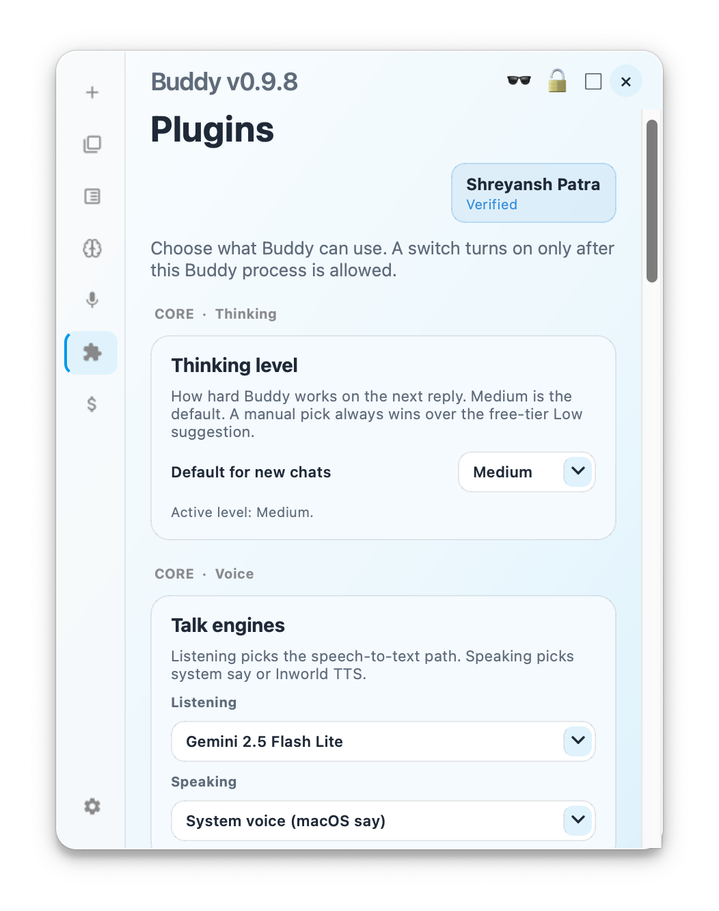
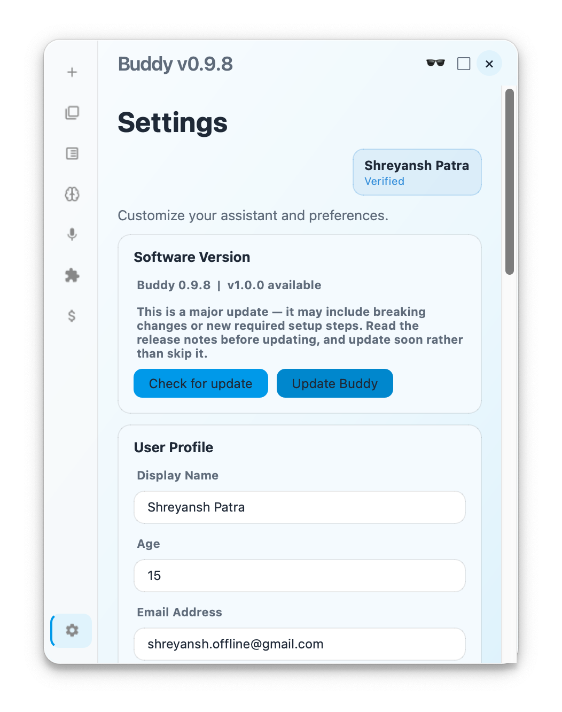

# Buddy

  

Buddy is a desktop AI assistant you can chat with, talk to, and ask to help with everyday computer work. It brings chat, voice, memory, and optional tools into one app, with a friendly interface and a live view of what it is doing.

Think of Jarvis but in this modern world

Buddy is an active beta. Some features need an AI provider, connected accounts, or operating-system permissions before they work. Its not perfect, but its great!

What makes Buddy different from other ai agents is that its homemade and made for the common people not for rich companies and rich people its made for people like you and me and other Hack Clubbers

> [!NOTE]
> Buddy keeps chats and memory on your computer by default. When you use an AI provider or connect a service, the information needed for that request is sent to that provider.

## A quick tour

- **Chat:** Talk through questions and tasks, see Buddy's progress, and return to saved conversations.
- **Talk:** Have a spoken conversation using your microphone and the available speech services on your computer.
- **Memory:** Review and manage facts and preferences Buddy has saved for future chats.
- **Plugins:** Connect services and enable computer tools with controls for their permissions.
- **Billing:** Manage Your Plans and subscriptions with buddy
- **Settings:** Manage what buddy knows about you and manage your preference like color schemes etc

Buddy's interface is a compact desktop app with a navigation sidebar and separate pages for these features. The chat view includes suggestions and a live work log, so you can follow along while Buddy works.

Try asking: **“What can you do?”** Buddy will give examples based on its capability guide in `knowledge/`.

## How it works

Buddy runs as a Python desktop app built with PySide6. `main.py` starts the interface and its local backend. When you send a message, a normal efficient worker looks at the request and decides if its a normal chat or if its a task that consists of multiple steps and action items. If its a simple request like "Hi! What can you do for me?"... Then it handles the request instead of passing it to expensive models and wasting their time. However if it gets a large task, then it sends it over to a trained manager who makes a plan for the request and classifies each step of the plan as a hard task, medium task, or easy task like opening an app. Then the appropriate worker and its enabled tools handle it. 

So for example if I ask Buddy "Search for a cake recipe, and if you find a good one create a draft email to my mom with the link then open up gmail on my browser so I can send it."

1. The common response model takes the call and forwards it to its manager model
2. The manager model creates a plan and assigns different models based on difficulty on it
3. The action models work in order and complete the steps listening to their manager but not following it blindly, this is so they dont just literally do exactly what the boss says cause usually that doesn't work well.
4. During all this time the app displays Buddy is thinking, then magically all of the things you asked it to do happen at once after a couple second wait.
5. Buddy logs all of these processes so you can click show your thinking and then it shows the plan and the actions buddy took

Buddy is designed to be as efficient as possible at the same time not being built of a million lines of code. Its not perfect and thats why I like it. I will continue to make updates and make sure Buddy doesn't waste tokens, money, or your time.

Chats, settings, and memory use a local SQLite database. Tool access depends on the plugins you enable, your connected accounts, and permissions granted to Buddy by your operating system. Actions that could remove data or make significant changes ask for confirmation.

> [!WARNING]
> AI can make mistakes. Review important answers and generated changes. Never paste passwords, API keys, or other secrets into a chat.
## See Buddy
These are some Screenshots of the live app after the first release. Look at these to understand the vibe of Buddy before downloading it.

<!-- Example: save a screenshot as docs/images/chat.png, then remove the HTML comment around the image below. -->
<!--  -->

<!-- Add more screenshots here, for example the Memory, Talk, or Plugins screens. -->
<!--  -->
<!--  -->
<!--  -->
<!--  -->

Don't like the color? Change it! There is a dark mode as well as many different soft color options with amazing gradients especially Hack Club Red 

## Download Buddy

Go to [**Releases**](https://github.com/shreyanshoffline/Buddy/releases/latest) and download the installer for your computer:

| Computer | Download |
| --- | --- |
| Mac with Apple silicon (M1 or newer) | The Apple silicon `.dmg` |
| Intel Mac | The Intel `.dmg` |
| Windows 10/11, 64-bit | The Windows `.exe` installer |
| Linux, x86_64 | The `.AppImage` or `.deb` |
| Chromebook with Linux enabled | The Linux `.deb` |

On Mac, open the folder and then the  `.dmg` and drag Buddy into **Applications**. On Windows, open the `.exe` and follow the installer. Linux and ChromeOS installation steps may differ by distribution.

> [!NOTE]
> Choose the Mac download that matches your processor. Apple silicon Macs use the Apple silicon DMG; older Intel Macs use the Intel DMG. The `.zip` files listed in Releases are for Buddy's updater, not the regular installer.

Unsigned downloads may show a security prompt on macOS or Windows. On macOS, you may need to approve Buddy in **System Settings → Privacy & Security** the first time you open it.

## Getting started
Buddy needs an AI key to work. The easiest option is a **free Hack Club AI key**:
1. Go to [ai.hackclub.com](https://ai.hackclub.com) and create a free account.
2. Copy your API key.
3. Open Buddy → Plans → Hacky Buddy → paste your key.
If you aren't a Hack Clubber, Any Open router Key Works as well but you must be responsible for your usage and you must pay for your usage

> [!NOTE]
> There is **no** Free plan currently because i haven't set up limits for api usage, However if you are part of Hack Club the hacky buddy plan is completely free with the steps above.

## Tour of the repository

| Folder or file | What's inside |
| --- | --- |
| `main.py` | Starts the desktop app and local backend |
| `gui/` | Screens, widgets, and images |
| `core/` | Chat orchestration, prompts, plugins, and updates |
| `tools/` | Computer actions and service integrations |
| `storage/` | SQLite database and migrations |
| `knowledge/` | Guides and capability instructions Buddy can use |
| `backend/` | Local service and runtime support |
| `packaging/` | App builds, installers, icons, and release guide |
| `.github/workflows/` | Automated tests and release builds |
| `tests/` | Offline regression tests |
| `ARCHITECTURE.md` | A concise map of how the code fits together |

## Credits

Buddy was created and is led by **Shreyansh**. The product direction, feature choices, and project decisions come from him.

AI tools were used for most of the user-interface implementation, to help with compilation and packaging, and to help write the instruction documents Buddy uses to guide its work. The project owner reviews and directs that work. Also these tools were used to set up a vague structure/skeleton of this readme, however I have inspected and edited all of this to make sure its correct

Made Possible with Hack Club and their sub-program Hack Club AI

## License

No license has been declared yet. Until one is added, treat this repository as source-available and ask before redistributing it.
